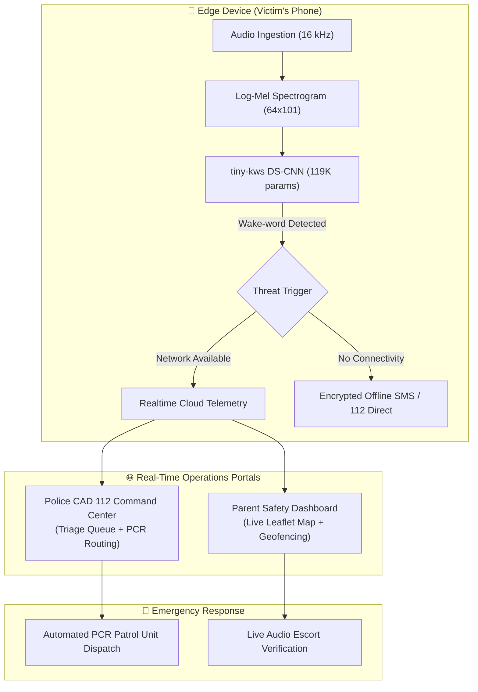

# SafeVaani 🛡️
> **Next-Generation Hands-Free Personal Safety & Autonomous Emergency Dispatch Ecosystem**

[](LICENSE)
[](ML-MODEL/)
[](ML-MODEL/assets/metrics.json)
[-blue.svg)](ML-MODEL/README.md)
[](security/)

SafeVaani is a multi-tier safety platform engineered for women, students, night-shift workers, and families across India. It couples **on-device keyword spotting (tiny-kws)** and **speech emotion recognition (MoodTune)** with real-time **geospatial telemetry**, an interactive **Parent Safety Console**, and a dedicated **Police 112 CAD Command Center**.

---

## ⚡ The Core Problem & Our Innovation

| Traditional Safety Apps | SafeVaani AI Ecosystem |
| :--- | :--- |
| **Requires physical interaction**: Must unlock phone, open app, and press panic button | **100% Hands-Free**: On-device speech recognition detects wake-words (*"help"*, *"bachao"*, *"madad"*) even with phone locked |
| **Cloud-dependent audio**: Streams raw audio to cloud servers, introducing latency and privacy risks | **Edge Inference**: Audio classified locally on-device in under 2ms. Zero listening audio is ever stored or uploaded |
| **Generic SMS alerts**: Sends static text links that family members often miss | **Live Tactical Telemetry**: Instant geofence alerts, live GPS map tracking, and automated PCR police unit dispatch routing |
| **High false-alarm rate**: Accidental pocket presses trigger unnecessary panics | **Dual-Engine Triage**: Emotion recognition + sound-impulse classification filters ambient noise before escalation |

---

## 🏗️ System Architecture



---

## 🧠 Machine Learning Subsystems

### 1. Edge Keyword Spotting (`tiny-kws`)
* **Location**: [`ML-MODEL/`](ML-MODEL/)
* **Architecture**: Depthwise-Separable Convolutional Neural Network (DS-CNN) with stem block, 4 depthwise-separable modules, and Global Average Pooling.
* **Model Size**: ~119K parameters (~0.48 MB fp32 weights).
* **Benchmark Performance**: **96.65% test accuracy** and **96.64% macro-F1** on Google Speech Commands v2 (speaker-disjoint test split).
* **Edge Latency**: **1.90 ms** mean inference on standard CPU (batch=1).

### 2. Speech Emotion & Distress Classifier (`MoodTune`)
* **Location**: [`emotion-detection/`](emotion-detection/)
* **Architecture**: Cross-corpus trained SER model (RAVDESS + CREMA-D) with speaker-stratified actor partitioning.
* **Key Innovation**: Collapses the cross-corpus generalization gap from 42 points down to 3 points, preventing "everything is angry" false alarms on real-world microphones.

---

## 🖥️ Platform Modules & Dashboards

1. **Interactive Web Application**:
   - [`index.html`](index.html): Responsive landing view with live browser voice simulator.
   - [`voice-sos/`](voice-sos/): Technical architecture and background wake-word mechanics.
   - [`features/`](features/): Audio escort, circle telemetry, safe zones, and battery monitors.
2. **Parent Real-Time Monitoring Portal**:
   - [`dashboard/parent/`](dashboard/parent/): Real-time child location tracking on Leaflet maps, geofence radius breach alerts, and battery indicators.
3. **Police 112 CAD Emergency Command Center**:
   - [`dashboard/police/`](dashboard/police/): Incident triage queue (`Critical` / `High`), audio evidence playback, and nearest PCR van dispatch routing.
4. **Multilingual Access Matrix**:
   - [`google-translate.js`](google-translate.js): Seamless toolbar supporting 9 Indian regional languages (Hindi, Marathi, Gujarati, Tamil, Telugu, Kannada, Bengali, Punjabi, English).
   - Dedicated vernacular portals in [`mahila-suraksha-app/`](mahila-suraksha-app/) and [`women-safety-app-india/`](women-safety-app-india/).
5. **Comparative Safety Matrix**:
   - [`compare/`](compare/): 15 side-by-side benchmark evaluations against 112 India, bSafe, Himmat, Satark India, and hardware devices.
6. **Safety Knowledge Base**:
   - [`blog/`](blog/): Over 70 guides on night shift transit, campus safety, and offline SOS telemetry.

---

## 🚀 Running Locally

### 1. Web Application & Dashboards
SafeVaani is built with optimized static architecture and vector graphics. Run instantly with any local HTTP server:

```bash
# Clone the repository
git clone https://github.com/college-hack24-nov26/hack-akatsuki.git
cd hack-akatsuki

# Start local server (Python 3)
python3 -m http.server 8088
```

Open [http://localhost:8088](http://localhost:8088) in your browser:
* **Landing Page**: `http://localhost:8088/`
* **Parent Dashboard**: `http://localhost:8088/dashboard/parent/`
* **Police 112 CAD Center**: `http://localhost:8088/dashboard/police/`

### 2. Edge ML Keyword Spotting Demo
```bash
cd ML-MODEL
pip install -r requirements.txt
python app/app.py
```

---

## 📁 Repository Directory Structure

```text
├── ML-MODEL/                 # Edge Keyword Spotting (tiny-kws PyTorch DS-CNN)
│   ├── src/                  # Model definition, training & evaluation scripts
│   ├── app/                  # Gradio microphone live test harness
│   └── assets/               # Metrics JSON & confusion matrices
├── emotion-detection/        # Speech Emotion Recognition (MoodTune SER)
├── dashboard/
│   ├── parent/               # Parent Safety Telemetry Console
│   └── police/               # Police CAD 112 Command Center
├── features/                 # Safety system specifications
├── voice-sos/                # On-device Voice SOS mechanics
├── compare/                  # 15 technical benchmark comparison reports
├── blog/                     # 70+ safety knowledge base articles
├── _astro/                   # Leaflet mapping engine & CSS design tokens
├── brand/ & art/             # SVG vector assets and brand marks
├── DEVELOPMENT_LOG.md        # Auditable milestone & commit changelog
├── site.webmanifest          # PWA configuration
└── vercel.json               # Clean URL deployment routing
```

---

## 🛡️ Privacy & Security Pledge
SafeVaani operates under a strict **Zero-Audio-Retention Policy**:
* Voice wake-word detection runs locally in hardware memory.
* Listening audio buffers are processed in temporary ring-buffers and discarded immediately.
* Audio recordings are only initiated upon verified emergency distress and shared exclusively with the user's pre-approved safety circle and authorized 112 dispatchers.

---

## 📝 Hackathon Engineering Log
Every development phase, test, and commit executed during the hackathon is recorded with exact timestamps in [**`DEVELOPMENT_LOG.md`**](DEVELOPMENT_LOG.md).
